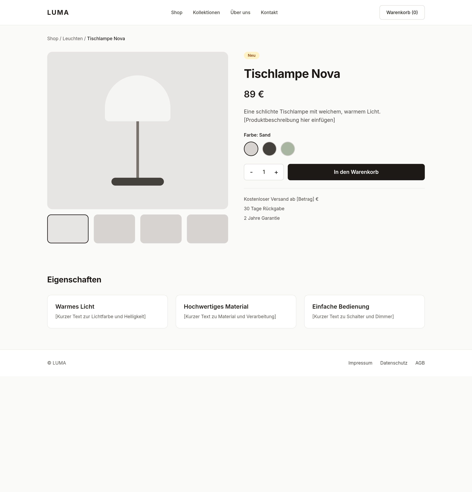
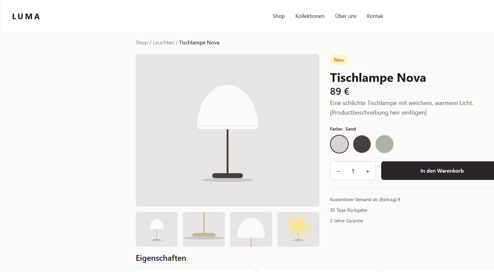

# LUMA – Produktseite

Ein Lernprojekt, um Tailwind CSS zu üben und zu zeigen, wie ich ein Design in sauberes HTML und CSS umsetze. Die Vorlage ist die Produktseite einer Tischlampe („Nova“).

## Design und Ergebnis

**Ursprüngliches Design**



**Meine Umsetzung**



## Was ich geübt habe

- Tailwind CSS: Utility-Klassen, Layout mit Flexbox und Grid, Abstände, Typografie
- Ein vorgegebenes Design möglichst genau umsetzen
- Formularelemente gestalten: Mengenwahl und Farb-Swatches
- Footer am unteren Seitenrand halten

## Starten

```bash
npm install
npm run twcss
```

Danach `index.html` mit einem lokalen Server öffnen, zum Beispiel mit der VS-Code-Erweiterung „Live Server“.

## Struktur

- `index.html`: die Seite
- `src/input.css`: Tailwind-Einstiegspunkt
- `src/output.css`: generiertes CSS, nicht von Hand bearbeiten
- `src/assets`: Bilder, Icons und Logo
